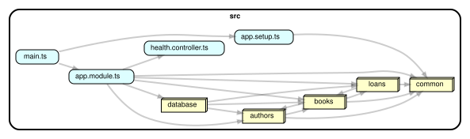

# Бібліотека: навчальний бекенд

## 1. Що це і для кого

Це маленький бекенд для бібліотеки: автори, книги, видачі книг читачам. Він написаний для фронтенд-розробника, який ніколи не писав серверний код і хоче побачити, з чого складається бекенд. Мета одна: відкрити проєкт і зрозуміти, як контролер, сервіс, репозиторій і сутність працюють разом.

Стек: Node 22, TypeScript, NestJS 11, PostgreSQL 16, TypeORM.

## 2. Як запустити

З Docker (потрібен тільки Docker):

```bash
docker compose up --build
```

Потім відкрити http://localhost:3000/reference. Там уся документація, і кожен запит можна виконати прямо зі сторінки.

Щоб наповнити базу тестовими даними:

```bash
docker compose exec app node dist/database/seed.js
```

Без Docker (потрібен Node 22 і запущений PostgreSQL 16):

```bash
cp .env.example .env        # вписати свої DB_HOST, DB_USER, DB_PASSWORD, DB_NAME
npm install
npm run migration:run       # створити таблиці
npm run seed                # 3 автори, 8 книг, 2 видачі
npm run start:dev           # застосунок на http://localhost:3000
```

Файл `requests.http` містить запити до кожного ендпоінта. Відкрий його у VS Code з розширенням REST Client.

## 3. Шлях одного запиту

Що відбувається, коли браузер надсилає `POST /loans` з тілом `{ "bookId": 3, "readerName": "Олена" }`:

```
 Браузер
   |
   |  POST /loans  { bookId: 3, readerName: "Олена" }
   v
+----------------------------------------------------------------+
| main.ts                                                        |
|   приймає HTTP-запит, дає йому requestId                       |
|   ValidationPipe перевіряє тіло за CreateLoanDto               |
|   (dto/create-loan.dto.ts). Поля не ті: одразу 400             |
+----------------------------------------------------------------+
   |
   v
+----------------------------------------------------------------+
| loans.controller.ts                                            |
|   @Post() borrow(dto)                                          |
|   нічого не вирішує, просто викликає сервіс                    |
+----------------------------------------------------------------+
   |
   v
+----------------------------------------------------------------+
| loans.service.ts                                               |
|   книги немає?               -> 404 NotFoundException          |
|   copiesAvailable === 0?     -> 409 ConflictException          |
|   інакше просить репозиторій видати книгу                      |
+----------------------------------------------------------------+
   |
   v
+----------------------------------------------------------------+
| loans.repository.ts                                            |
|   одна транзакція:                                             |
|     UPDATE books SET copiesAvailable = copiesAvailable - 1     |
|     INSERT INTO loans (bookId, readerName)                     |
+----------------------------------------------------------------+
   |
   v
+----------------------------------------------------------------+
| PostgreSQL                                                     |
|   таблиці books і loans (описані в book.entity.ts,             |
|   loan.entity.ts, створені міграцією database/migrations/)     |
+----------------------------------------------------------------+
   |
   |  рядок таблиці loans
   v
 loans.repository.ts   повертає обʼєкт Loan
   |
   v
 loans.service.ts      перетворює Loan на LoanResponse (dto/loan-response.dto.ts)
   |
   v
 loans.controller.ts   віддає його Nest
   |
   |  201 Created  { id: 3, bookId: 3, readerName: "Олена", returnedAt: null }
   v
 Браузер
```

Якщо на будь-якому кроці кинуто помилку, її ловить `common/http-exception.filter.ts` і віддає браузеру у вигляді `{ statusCode, error, message, requestId }`.

## 4. Чотири шари

**Контролер** (`*.controller.ts`). Описує HTTP-маршрути: який метод, яка адреса, що в тілі, що в query. Бере параметри з запиту і передає їх сервісу, результат віддає назад. Він НЕ повинен містити логіку: жодних "якщо немає примірників", жодних звернень до бази.

**Сервіс** (`*.service.ts`). Бізнес-правила: що можна, а що ні. Саме тут вирішується, що книгу без вільних примірників видати не можна (409), а неіснуючу знайти не можна (404). Він НЕ повинен знати про HTTP (запити, заголовки, статуси як такі) і НЕ повинен писати SQL.

**Репозиторій** (`*.repository.ts`). Усі звернення до бази для однієї таблиці зібрані в одному класі: знайти, створити, зберегти, видалити. Знає про TypeORM і транзакції. Він НЕ повинен приймати бізнес-рішення: не кидає 404 чи 409, просто повертає `null`, якщо запису немає.

**Сутність** (`*.entity.ts`). Опис таблиці: які колонки, якого типу, які звʼязки. TypeORM за цим описом будує SQL. Вона НЕ повинна містити методів з логікою і НЕ повертається клієнту напряму: для відповіді є окремий DTO (`dto/*-response.dto.ts`).

### Карта залежностей



Кожен вузол це каталог `src/<name>` (`books`, `authors`, `loans`, `common`, `database`) або окремий файл верхнього рівня, стрілка `A -> B` означає "файли з A імпортують щось із B": `loans` залежить від `books`, бо видача перевіряє примірники (а `books` від `loans` лише через сутність `Loan` у репозиторії, тому стрілки в обидва боки), усі три модулі спираються на `common` (помилки, пагінація), а `main.ts` лише збирає інше і сам нікому не потрібен. Повний граф по файлах (контролер, сервіс, репозиторій, сутність кожного модуля окремо): [docs/graphs/files.svg](docs/graphs/files.svg); перегенерувати обидва: `npm run graph` і `npm run graph:files` (потрібен Graphviz, команда `dot` у PATH); перевірити правила (без циклічних імпортів, `src` не імпортує `test`): `npm run deps:check`.

Довідка по коду (Compodoc): `npm run docs:code`, потім відкрити `docs/compodoc/index.html` у браузері. Сторінка "Modules" показує для кожного Nest-модуля його controllers, providers і imports, тобто те, що `@Module({...})` збирає докупи, і з чого складається граф вище.

## 5. Словничок

- **HTTP-метод**: дієслово запиту. GET читає, POST створює, PATCH змінює частину, DELETE видаляє.
- **Маршрут**: адреса, на яку відповідає контролер, наприклад `GET /books/:id`. `:id` означає "тут буде число".
- **DTO** (Data Transfer Object): клас, який описує форму даних на вході або виході. На вході ще й перевіряє їх.
- **Сутність**: клас, який описує таблицю в базі. Одне поле класу дорівнює одній колонці.
- **Міграція**: файл зі змінами схеми бази (створити таблицю, додати колонку). Виконується один раз, база памʼятає, які вже застосовані.
- **Транзакція**: кілька SQL-операцій, які виконуються як одна: або всі, або жодна.
- **404 vs 409**: 404, коли запису з таким id не існує. 409, коли запис існує, але дія суперечить його стану (немає вільних примірників, книгу вже повернули).
- **Seed**: скрипт, який наповнює порожню базу стартовими даними, щоб було з чим працювати.

## 6. Ендпоінти

| Метод | Маршрут | Вхід | Вихід | Помилки |
|---|---|---|---|---|
| GET | /health | нічого | `{ status, database }` | 500, якщо база не відповідає |
| GET | /authors | query: `page`, `pageSize` | сторінка авторів | 400 |
| GET | /authors/:id | id в URL | автор | 404 |
| POST | /authors | `{ name, country }` | 201, автор | 400 |
| PATCH | /authors/:id | `{ name?, country? }` | автор | 400, 404 |
| DELETE | /authors/:id | id в URL | 204, без тіла | 404, 409 (в автора є книги) |
| GET | /books | query: `page`, `pageSize`, `authorId`, `q` (частина назви) | сторінка книг | 400 |
| GET | /books/:id | id в URL | книга разом з `author` | 404 |
| POST | /books | `{ title, year, authorId, copiesTotal }` | 201, книга | 400, 404 (автора немає) |
| PATCH | /books/:id | `{ title?, year?, authorId? }` | книга | 400, 404 |
| DELETE | /books/:id | id в URL | 204, без тіла | 404, 409 (книга має видачі) |
| GET | /loans | query: `page`, `pageSize`, `active` (true або false) | сторінка видач | 400 |
| POST | /loans | `{ bookId, readerName }` | 201, видача | 400, 404 (книги немає), 409 (немає вільних примірників) |
| POST | /loans/:id/return | id видачі в URL | видача з `returnedAt` | 404, 409 (вже повернули) |

Детальніше про формат сторінки і помилки: `docs/ENDPOINTS.md`.

## 7. Спробуй сам

Завдання від простого до складнішого. У кожному сказано, які файли чіпати.

**а) Додати `GET /books/:id/loans`**: список видач однієї книги.
Файли: `src/loans/loans.repository.ts` (метод `findByBookId`), `src/loans/loans.service.ts` (метод `findByBook`, який спочатку перевіряє через `booksRepository`, що книга існує, інакше 404), новий `src/loans/book-loans.controller.ts` (клас з `@Controller('books')` і маршрутом `@Get(':id/loans')`, який викликає `LoansService`), `src/loans/loans.module.ts` (додати новий контролер у `controllers`). Підказка: контролер лежить у модулі видач, а не книг, бо йому потрібен `LoansService`, а модуль книг про видачі не знає.

**б) Додати сутність Reader** і звʼязати видачі з нею замість поля `readerName`.
Файли: новий `src/readers/reader.entity.ts` (id, name, email, createdAt), нова міграція в `src/database/migrations/` (створити таблицю `readers`, у `loans` замінити `readerName` на `readerId`), `src/loans/loan.entity.ts`, `src/loans/dto/create-loan.dto.ts` (`readerId` замість `readerName`), `src/loans/dto/loan-response.dto.ts`, `src/loans/loans.service.ts` (перевірка, що читач існує), `src/database/data-source.ts` (додати сутність і міграцію до списків), `src/database/seed.ts`.

**в) Додати валідацію: рік книги не може бути в майбутньому.**
Файли: `src/books/dto/create-book.dto.ts` і `src/books/dto/update-book.dto.ts`. Підказка: `@Max()` з class-validator приймає число, а поточний рік це `new Date().getFullYear()`.

**г) Додати тест на 409 при видачі книги.**
Файли: `test/app.e2e-spec.ts` (e2e: створити автора, книгу з `copiesTotal: 1`, видати двічі, другий раз очікувати 409) і `src/loans/loans.service.spec.ts` (unit: подивись, як там зроблено тест "кидає 409, якщо вільних примірників немає", і напиши такий самий для випадку, коли книга має 2 примірники і її видають тричі).

## 8. Тести

```bash
npm test          # unit-тести, база не потрібна
npm run test:e2e  # e2e-тести, потрібна запущена PostgreSQL (налаштування з .env або змінних DB_*)
```

Unit-тести перевіряють один сервіс окремо, а замість репозиторію підставляють простий клас з масивом у памʼяті, тому вони швидкі і не потребують бази. E2E-тести піднімають весь застосунок і надсилають справжні HTTP-запити до справжньої бази, тому перевіряють увесь шлях від контролера до PostgreSQL.
